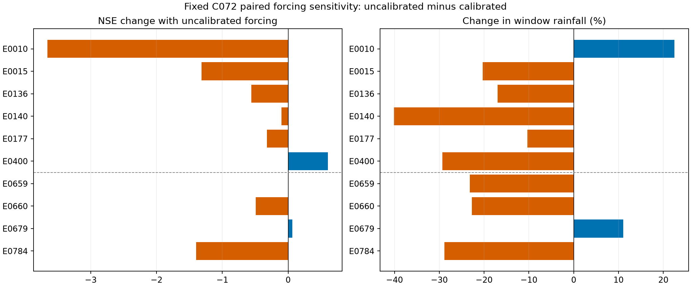

# Satellite rainfall–runoff modelling with HEC-HMS

**Choctawhatchee River near Newton, Alabama — USGS 02361000**

A completed research case study of GPM IMERG Final V07 rainfall, USGS discharge,
automated HEC-HMS calibration, held-out evaluation and rainfall-forcing sensitivity.
**The model did not meet the project performance criteria.** This repository
documents that result transparently; it is not an operational flood forecasting model.

## Reusable dashboard for your own basin

[Open the dashboard source and instructions](dashboard/README.md). Runoff Lab is a
standalone, browser-local workspace for any watershed: configure a study, register
datasets, set event criteria, manage evidence and track HEC-HMS readiness. It opens with a read-only demo of this case study, including dataset summaries,
ten selected events, source-linked evidence, published figures and limitations.
Users can make an editable copy or start a blank project for their own basin.
Copies reset review statuses and model-readiness checks; no local filesystem paths
or credentials are included.
Each visitor’s records stay in their own browser and can be exported as JSON.

From the repository root, run `python -m http.server 8080` and open
http://localhost:8080/dashboard/. No build or dependency installation is required.

## Main results

| Experiment | Calibrated IMERG mean NSE | Uncalibrated IMERG mean NSE |
|---|---:|---:|
| Six calibration events | -0.479 | -1.370 |
| Four evaluation events | -0.220 | -0.676 |

The search tested 80 shared parameter sets across six events (480 simulations).
The retained baseline **C072** has CN 68, initial abstraction 23.91 mm,
Clark time of concentration 18 h, storage coefficient 70 h and daily recession
constant 0.99. Four held-out runs followed without tuning. Ten additional runs
changed only the rainfall product band. The latter are a sensitivity comparison
on already examined events, not a second independent validation.

Only one calibration event had positive NSE. One of four held-out events had
NSE 0.708, but no held-out event passed all project screens. Negative NSE means
squared-error performance was worse than using that event's observed mean flow.
Substituting uncalibrated IMERG improved NSE in two events, tied one and worsened
seven. It did not rescue the baseline or establish either product's rainfall accuracy.

## Why performance was poor

The evidence shows inconsistent runoff-volume response across events: C072
overproduced direct runoff in E0010 and E0400 and underproduced it in the other
four calibration events. Two background-flow assumptions retained the strongest
mismatches. Changing travel time alone cannot supply missing rainfall excess.

Likely contributors are inadequate antecedent moisture/initial-state representation,
earlier-event carryover and delayed flow, event-dependent rainfall errors, and the
single-subbasin model structure. **These are hypotheses, not identified causes.**
No independent rainfall reference was used. See [failure analysis](docs/WHY_PERFORMANCE_WAS_POOR.md).

## How this could be improved

1. Benchmark event rainfall against independent gauges or radar before more tuning.
2. Audit antecedent wetness, earlier storms and initial flow; test a physically
   justified state-aware loss/baseflow treatment in a new experiment.
3. Investigate spatial rainfall and subbasin/routing structure only where evidence supports it.
4. Freeze a limited new experiment and evaluate it on genuinely unseen events.

See the required, prioritized [improvement plan](docs/IMPROVEMENTS.md) for evidence,
tests and decision rules. More blind calibration is not the recommended next step.

## Read and reproduce

- [Final report (PDF)](report/Project_02_Final_Report.pdf) and [Markdown](report/Project_02_Final_Report.md).
- [Ten-event baseline metrics](tables/ten_event_metrics.csv).
- [Paired forcing metrics](tables/forcing_paired_event_metrics.csv).
- [Stormflow audit](tables/six_event_stormflow_audit.csv).
- [Reproducibility instructions](docs/REPRODUCIBILITY.md), [data and attribution](docs/DATA_SOURCES.md).
- `scripts/` contains historical acquisition and processing code. Full automation,
  protocols, processed inputs and all 494 saved hydrographs are in the separate evidence ZIP.

## Important boundaries

All model clocks use UTC and 30-minute intervals. Rainfall start labels were
shifted to interval ends; observed flow was sampled without interpolation.
The 1779.24 km² catchment is represented by one lumped subbasin.
E0659/E0660 overlap by 15.5 hours (32 shared timestamps); four rows do not mean
four independent samples. The overlap-group mean baseline NSE is -0.176.
Both HEC-HMS sampled-flow bias and trapezoidal volume bias are reported and distinguished.
Historical configuration strings are superseded by the frozen protocols in the archive.

This is a reproducible documented experiment, not proof of physical validity.
Offline evidence verification passed; a clean-machine simulator rerun and fresh
cloud extraction have not been demonstrated. Original project files were preserved.
Original project contributions use the repository's [Apache 2.0 license](LICENSE); third-party data retain their own terms.
