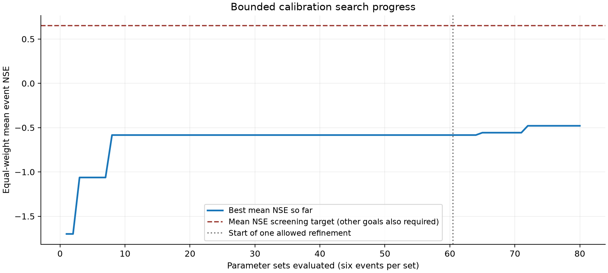
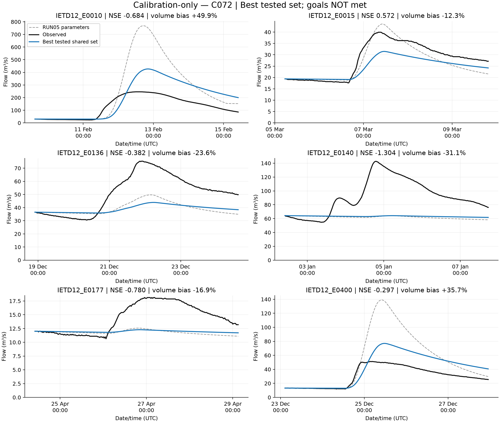
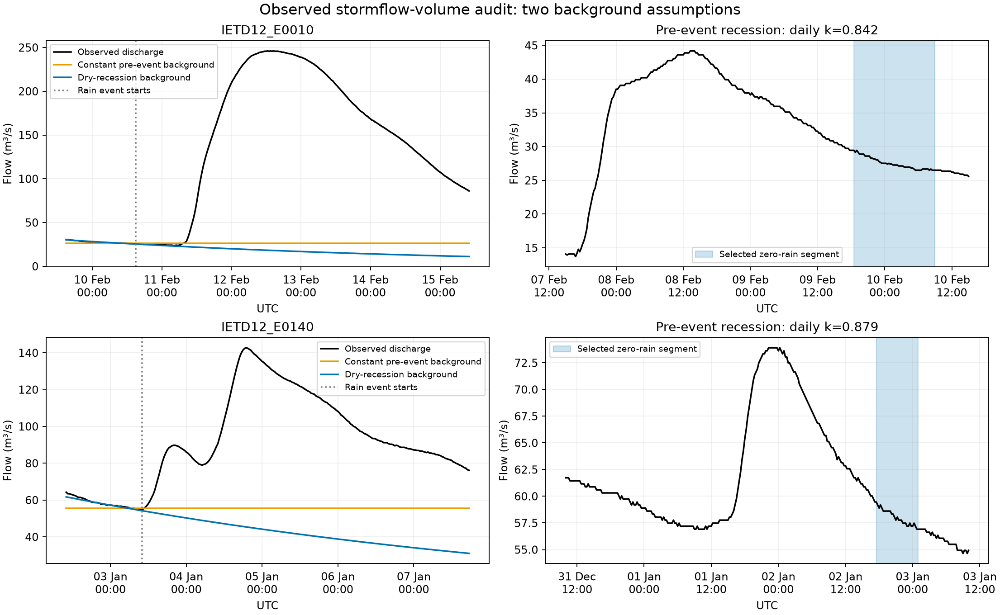
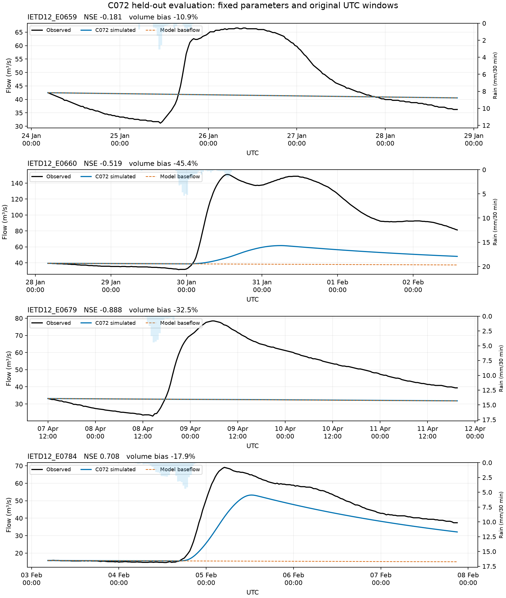

Project 2 final baseline study report | Choctawhatchee River near Newton, Alabama | 2 November 2026

## Executive finding

The calibrated GPM IMERG V07 event-model baseline did not reproduce rainfall-runoff responses consistently across six calibration and four held-out events. The finite calibration search and locked held-out evaluation are complete. Neither met the project performance criteria. C072 is retained as the final evaluated baseline, with unsuccessful calibration explicitly recorded.

| Measure | Result |
|---|---|
| Calibration experiment | 80 parameter sets, 480 saved event runs |
| Best tested shared model | C072: CN 68, Ia 23.91 mm, Tc 18 h, R 70 h, k 0.99 |
| Mean calibration NSE | -0.479 |
| Mean held-out NSE | -0.220 |
| Overlap-group held-out NSE | -0.176 |
| Operational status | Research baseline; acceptance criteria failed |

The strongest volume mismatch survives two independent background-flow assumptions. E0140 requires substantially more storm response than the tested loss rule generates, whereas E0010 and E0400 have excessive simulated direct outflow. The available evidence does not isolate soil state, rainfall error or earlier-event carryover as the cause.

No new simulations were run for this finalization. The original GUI project and protected inputs were preserved. Completion here means completion of the frozen baseline experiment and its documentation, not successful physical validation or operational readiness.

### Scope boundary

This report closes the calibrated IMERG baseline study. A comparison using uncalibrated IMERG, mentioned in the original planning log, was not performed. It remains a separate uncompleted extension if required by the broader project brief. No independent rain-gage reference or end-to-end fresh cloud extraction was added.

## Catchment data and model construction

The study uses USGS station 02361000, Choctawhatchee River near Newton, Alabama. Model area is the accepted polygon-derived 1779.24 km². The station area recorded locally is 686 mi², or 1776.73 km²; the approximately 0.14% difference was retained and is not a fitted parameter. [L1]

| Input or method | Evidence and treatment |
|---|---|
| Primary period | 2018-01-01 to 2024-12-31; selected event windows only for modelling |
| Precipitation | GPM IMERG Final Run V07 calibrated precipitation band; basin-area mean; 30-minute depth |
| Discharge | USGS parameter 00060; source ft³/s multiplied by 0.028316846592; exact half-hour observations |
| Physical starting information | NLCD 2021, SSURGO hydrologic soil groups, 3DEP terrain; saved parameter and QC summaries |
| Spatial structure | One lumped subbasin; no explicit reach routing |
| Methods | SCS CN loss; Clark unit hydrograph with default time-area curve; recession baseflow |
| Fixed settings | Area 1779.24 km²; impervious 0%; baseflow ratio-to-peak 0.20; no canopy or surface method |

The IMERG record contains 122,736 expected half-hour intervals in the saved 2018-2024 extraction checks. The whole-period discharge completeness was 98.5766%, with estimated observations present in the wider archive. This does not imply gap-free discharge globally: the ten selected event windows separately passed completeness and estimated-value checks. [L1, L2]

The calibrated IMERG product band is distinct from hydrologic parameter calibration. Its product name does not establish local rainfall accuracy. Uncalibrated-band differences are not measured precipitation errors without an independent reference.

### UTC and interval audit

Source rain timestamps label interval starts. HEC-HMS incremental accumulations were assigned to interval ends by adding 30 minutes; the existing depth column was not multiplied by 0.5 again. Observed flow was sampled at exact half-hour timestamps with no interpolation. Inputs used seven-decimal entry precision. Event Q0 was control-start observed flow rounded to five decimals. [L3]

The initial GUI project carried Asia/Karachi labels. Direct source-to-DSS checks and a UTC-copy recomputation established matching numerical clocks rather than assuming a five-hour shift. Automated RUN05 reproduction matched 55 stored statistics and all 221 flow ordinates. The original project was preserved. [L3]

## Events experiment and stopping rules

| Event | Role | Control start UTC | Control end UTC |
|---|---|---|---|
| E0010 | calibration | 2018-02-09 15:00 | 2018-02-15 10:00 |
| E0015 | calibration | 2018-03-05 05:30 | 2018-03-09 19:30 |
| E0136 | calibration | 2018-12-18 22:00 | 2018-12-24 14:30 |
| E0140 | calibration | 2019-01-02 10:00 | 2019-01-07 17:30 |
| E0177 | calibration | 2019-04-24 10:00 | 2019-04-29 03:00 |
| E0400 | calibration | 2020-12-23 02:30 | 2020-12-27 23:00 |
| E0659 | validation | 2023-01-24 04:30 | 2023-01-28 19:30 |
| E0660 | validation | 2023-01-28 04:00 | 2023-02-02 14:00 |
| E0679 | validation | 2023-04-07 12:00 | 2023-04-11 19:30 |
| E0784 | validation | 2024-02-03 04:30 | 2024-02-07 21:00 |

Event IDs have the full IETD12_ prefix in all files. IETD denotes the catalogue inter-event dry-time setting; this catalogue uses 12 hours. Six calibration and four validation events were user-confirmed before fitting. E0264 remained reserve and was not substituted. All windows retain the catalogue 24-hour lead and 72-hour tail without post-fit resizing. [L2, L4]

One common vector was applied to all calibration events. Bounds were CN 50-75, Tc 15-55 h, R 10-70 h and daily recession k 0.80-0.99. Initial abstraction was derived from 0.2 times S, with S determined by CN, rounded to two decimals; it was not a fifth fitted parameter. [H1, L4]

The initial 60 sets comprised the physical vector, RUN05 vector, eight one-at-a-time bounds and 50 Latin-hypercube samples with seed 236100. Failure of the best initial set permitted one 20-set local refinement with seed 236101. The hard limit was 80 sets or 480 event runs, regardless of performance. All 80 candidates were valid numerical runs. [L4, L5]

Ranking maximized the equal-event mean NSE. Near ties within 1e-6 used worst NSE, mean absolute volume bias, peak error, timing error and candidate ID in that order. Validation was excluded from fitting, refinement and stopping. These are analyst-defined decisions, not universal calibration standards.

## Calibration results and final baseline

| Event | NSE | Mod KGE | HMS bias % | Peak error % | Timing h |
|---|---|---|---|---|---|
| E0010 | -0.684 | 0.453 | +49.9 | +73.5 | +8.0 |
| E0015 | 0.572 | 0.636 | -12.3 | -21.2 | +3.0 |
| E0136 | -0.382 | 0.204 | -23.6 | -41.7 | +9.0 |
| E0140 | -1.304 | -0.362 | -31.1 | -55.0 | -57.0 |
| E0177 | -0.780 | 0.003 | -16.9 | -32.2 | -2.5 |
| E0400 | -0.297 | 0.582 | +35.7 | +50.3 | +8.0 |

C072 was the best tested shared set: CN 68, Ia 23.91 mm, Tc 18 h, R 70 h and k 0.99. Its mean calibration NSE was -0.479205. Only E0015 had positive NSE. R and k reached the upper search bounds; this was not treated as justification for expansion. All five project goal categories failed. [L5]

The initial-stage best was C008 with mean NSE -0.583700. Refinement improved this by 0.104495, but the final result remained inadequate. A bounded search finding is not proof that no vector within the continuous bounds could work.

Figure 1. Saved search progress. The search ended at its agreed hard cap. Calibration bias in the table is HEC-HMS sampled-flow bias, used in the frozen search. Harmonized trapezoidal values are also provided in tables/ten_event_metrics.csv; candidates were not reranked after validation.

The E0140 simulated maximum was initialized background flow at control start, not a represented storm peak. Its -57 h timing error must not be interpreted as a travel-time correction target. NSE and peak/volume diagnostics retain this failed event.

## Calibration hydrograph evidence

Figure 2. C072 on all six calibration events, using the saved full windows. Good shape or magnitude for one event does not demonstrate transferability across the set. [L5]

Screens were mean NSE at least 0.65; every event NSE at least zero; every absolute volume bias at most 20%; every absolute peak error at most 25%; and every absolute timing error at most six hours. All categories failed. The thresholds were fixed analyst-defined screens, not external acceptance standards.

The saved model uses recession baseflow initialized from total observed flow at each control start. It does not independently initialize soil moisture or identify groundwater-only flow. Initial conditions and structural parameters can therefore compensate for one another. Multi-event and initial-state checks are consistent with HEC calibration guidance. [H2, H3]

## Stormflow volume diagnosis

| Event | Rain mm | Constant mm | Recession mm | CN75 excess mm |
|---|---|---|---|---|
| E0010 | 157.36 | 29.29 | 31.26 | 87.61 |
| E0015 | 40.51 | 2.15 | 2.53 | 5.14 |
| E0136 | 38.24 | 5.22 | 6.94 | 4.29 |
| E0140 | 29.92 | 9.41 | 12.21 | 1.73 |
| E0177 | 27.26 | 0.71 | 0.98 | 1.12 |
| E0400 | 65.21 | 4.22 | 4.42 | 17.53 |

These are estimated within-window stormflow depths over the model area, not directly measured runoff. Background assumption A was constant observed mean flow over the six hours before rainfall onset. Assumption B was an exponential extrapolation fitted to the latest eligible zero-IMERG-rain recession in the prior 72 hours. No model baseflow was subtracted from observations. [L6]

Eligibility required at least six hours, complete half-hour flow, a negative log-flow slope, lower ending flow, log-linear R² at least 0.8 and at most 20% rising increments. All four additional events had eligible segments. An older E0177 segment with two missing observations was excluded without interpolation. These screening rules were carried forward unchanged from the initial two-event audit.

Stormflow was the positive residual above each background, integrated trapezoidally. Background was capped at observed flow for the accounting identity; negative-residual clipping was disclosed. Sensitivity used 3/6/12-hour constant means, conservative control-start flow and other eligible recession segments. Scenario ranges are not statistical confidence intervals.

E0140 estimates of 9.41-12.21 mm exceed the original CN 75 loss ceiling of 1.73 mm. E0136 estimates also exceed its 4.29 mm ceiling under both primary assumptions. E0010 and E0400 have C072 direct outflow above both estimated stormflow values. Routing changes alone cannot create additional rainfall excess, but these residuals cannot uniquely identify rainfall or soil-state error. [H1, L6]

The contrasting events do not support one simple monotone antecedent-rainfall correction. Earlier storm drainage can remain in the background, and short fitted recessions are extrapolated across several days. A zero IMERG value does not prove zero true rainfall. E0140 had 47.58 mm in the prior seven days, including 39.20 mm five to six days before onset; its preceding flow pulse is consistent with carryover or rainfall-representation uncertainty, not a unique causal diagnosis.

## Background assumptions and decision

Figure 3. The original contrasting-event audit. Constant and declining backgrounds bound two explicit assumptions rather than providing independent measurements of baseflow. [L6]

Across all six events, background-sensitivity ranges were E0010 28.36-32.66 mm, E0015 1.96-2.83 mm, E0136 4.35-6.94 mm, E0140 7.47-14.59 mm, E0177 0.60-0.98 mm and E0400 4.09-4.42 mm. The within-window 15-minute versus 30-minute integration differences were below 0.0031 mm.

The evidence supported closing the existing search and retaining C072 as a final evaluation baseline with failed calibration criteria. It did not support widening bounds, fitting CN separately per event, automatically replacing the loss method or tuning against holdouts. This model decision was recorded before validation. [L7]

Generated excess, routed direct outflow, total simulated discharge and separated stormflow are distinct quantities. At C072, only about 60-66% of generated excess appeared as direct outflow in the calibration windows. That difference is consistent with delayed routing, not an independent measurement of remaining physical storage. Windows were not extended after seeing the fit.

## Held out evaluation and overlap

| Event | NSE | Mod KGE | Vol bias % | Peak error % | Timing h |
|---|---|---|---|---|---|
| E0659 | -0.181 | -0.451 | -10.9 | -36.2 | -51.0 |
| E0660 | -0.519 | 0.189 | -45.4 | -59.2 | +17.0 |
| E0679 | -0.888 | -0.628 | -32.5 | -57.8 | -41.5 |
| E0784 | 0.708 | 0.768 | -17.9 | -22.9 | +7.5 |

Exactly four held-out event simulations were completed, once each, with unchanged C072 parameters. Mean NSE was -0.219775 and mean modified KGE was -0.030235. E0784 performed best, with NSE 0.708486, volume bias -17.91% and peak error -22.94%, but its peak was 7.5 h late. No event passed all its individual screens; all five overall goal categories failed. [L8]

E0659 rainfall was 14.81 mm, below the 23.91 mm initial abstraction, and generated excess was zero. E0679 generated only 0.01653 mm excess. Their simulated maxima at initialization give timing errors of -51 h and -41.5 h, which remain reported but do not describe realistic storm-peak timing.

### Overlap handling

E0659 and E0660 overlap on 28 January 2023 from 04:00 to 19:30 UTC: 15.5 h, 32 shared half-hour timestamps and 31 shared intervals. Both full windows were retained. The 918 event-table rows represent 886 distinct timestamps; neither count is an independent sample size. No pooled NSE, pooled bias, stitched hydrograph or summed discharge volume was reported.

The supplementary mean across three groups, mean(E0659,E0660), E0679 and E0784, gave NSE -0.176452 and modified KGE 0.003248. This is descriptive sensitivity to group weighting, not proof of independence or a replacement acceptance rule.

### Approved verification correction

Execution paused after E0659 because the verifier incorrectly equated HMS percent bias with bias derived from trapezoidal volumes. Saved outputs established that HMS uses all inclusive flow samples for its bias statistic; its reported depths match trapezoidal integration. Both definitions were independently reproduced. The user approved documenting the correction, retaining trapezoidal volume bias as primary and running only the remaining three events. E0659 was not rerun and the original protocol files remain unchanged.

For E0659 the two biases are -10.8296% (HMS samples) and -10.8916% (trapezoid). Both definitions for all ten events are retained in the harmonized table. Volume-screen classifications in validation are identical under either definition. No parameter or window choice resulted from this correction.

## Validation hydrograph evidence

Figure 4. All four held-out events with observed flow, C072 flow, model baseflow and interval rainfall. The small responses in E0659/E0679 and underpredicted E0660 peak are retained. All four logs had no warnings or errors; calibration had the disclosed auxiliary-log WARNING 10168 exception. [L5, L8]

## Reproducibility and limitations

The archive preserves the two full processed forcing/discharge source CSVs, original configuration and decision logs, event catalogue and fixed split, physical/QC summaries, original GUI snapshot, UTC reference, 80-set design and all 480 calibration outputs, frozen C072 model, diagnostics, protocol and all four validation outputs. Source acquisition scripts are retained; terrain rasters, raw cloud acquisitions, HEC binaries, Python environments and live .access files are not bundled.

An offline verifier checks every packaged file against SHA-256 and recomputes NSE for the 480 saved calibration hydrographs plus four validation hydrographs. It checks validation volume definitions, aggregate results, event counts and duplicated overlap observations. It neither launches HEC-HMS nor downloads data. A ZIP integrity test and manifest comparison are part of release checks.

Existing simulation scripts record absolute Windows paths and require HEC-HMS 4.14 with bundled Java/Jython and DSS libraries. Relocation requires explicit path adaptation in a separate working copy; the original scripts are preserved as evidence, not advertised as portable one-command executables. Saved-result verification is portable with Python standard library. A fresh clean-machine rerun of all simulations and a fresh cloud extraction were not performed during finalization.

### Interpretive limits

The study evaluates one lumped event architecture, one product forcing, one fixed finite search and ten selected events. Earlier visual-review CSV fields and configuration split labels remain historical; the later confirmed split and final lock are authoritative. Good numerical execution and source integrity do not establish physical adequacy.

Observed start-flow initialization gives the model information at event start; these are not forecasts without discharge observations. Soil moisture, groundwater-only flow, rating-curve changes and satellite error are not independently observed here. Overlapping validation windows and within-hydrograph serial dependence limit inferential claims. No claim of rainfall accuracy, robust operational prediction or universal method failure follows.

### Evidence access

Read README.md at package root, then run python verify_package.py for offline checks. reports and tables are indexed there. Reproduction status distinguishes demonstrated original RUN05 replication, archived simulations, recomputed metrics and untested clean-environment execution. Do not run the simulator scripts merely to inspect this package.

## Closure and remaining work

The authorized calibrated IMERG baseline experiment is complete: data checks, UTC alignment, six-event finite calibration, stormflow diagnosis, final baseline decision, four-event locked validation and final reporting. Calibration and held-out screening failed; the final model is a documented research baseline. This is a completed negative transferability finding, not a successful calibrated predictive model.

| Item | Status or remaining action |
|---|---|
| Current baseline study | Complete after release verification of this report and archive |
| Original project | Preserved; no edits needed to complete this scope |
| Reader or supervisor review | Review scientific interpretation and any institutional formatting or submission requirements |
| Broader original forcing comparison | Uncalibrated IMERG sensitivity was planned but not executed; separate extension if mandatory |
| Improved model or independent rain reference | Future study, not an unfinished task silently added here |
| More fitting on the four holdouts | Not permitted; they have now been seen and are not fresh validation events |

Current baseline work is 100% complete when package verification passes. The broader original plan cannot be called 100% complete if the uncalibrated-forcing sensitivity is a required deliverable. No further simulations are needed to close the baseline scope. Any extension must specify a new design and stopping rule and must not reuse these holdouts as unseen evidence.

### Local evidence index

[L1] results/tables/: catchment QC, physical starting parameters, discharge QC and IMERG extraction summaries.

[L2] outputs/event_split_confirmation/: confirmed split, selected-window completeness and metadata.

[L3] outputs/run05_reproduction_20261101_verified/ and outputs/run05_time_audit/: exact reproduction and numerical clock checks.

[L4] outputs/calibration_batch_preparation/: fixed search plan, seeds, bounds and input preparation.

[L5] outputs/calibration_batch_execution_20261101/: ledger, search result, candidate outputs and C072 project.

[L6] outputs/calibration_failure_review/, outputs/stormflow_volume_audit/ and package tables/six_event_stormflow_audit.json: diagnostic evidence.

[L7] outputs/final_baseline_validation_lock_20261102/: final baseline and immutable validation protocol.

[L8] outputs/C072_validation_execution_20261102/: four-run results, approved verifier correction and preservation records.

## Methods references and release statement

[H1] HEC SCS Curve Number Loss Model

https://www.hec.usace.army.mil/confluence/hmsdocs/hmstrm/canopy-surface-infiltration-and-runoff-volume/infiltration/scs-curve-number-loss-model

[H2] HEC Recession Model

https://www.hec.usace.army.mil/confluence/hmsdocs/hmstrm/baseflow/recession-model

[H3] HEC Model Calibration

https://www.hec.usace.army.mil/confluence/hmsdocs/hmsrd/model-calibration-355276362.html

References were checked on 2 November 2026. HEC references support model-method descriptions and general calibration practice; the finite budgets, screening thresholds, event choices and background-separation rules are project decisions. Numerical findings derive from local saved evidence. No literature claim substitutes for local physical validation.

### What was and was not verified

Verified: original and protected hashes, archived file integrity, saved-result metric recomputation, complete event inclusion, holdout separation during fitting, final protocol adherence with the approved bias-verifier correction, and the absence of new simulation commands during finalization.

Not verified by this release: clean-machine HEC-HMS execution after relocation, fresh satellite/cloud extraction, operational forecasting, independent ground-truth rainfall accuracy, or physical groundwater/soil-state identification. These boundaries remain explicit in the report and archive README.

The frozen search and final C072 files remain authoritative. Packaging adds new records only. Original configuration and historical decision files are reproduced without rewriting their older status labels. Use the confirmed split and final protocol manifests for the final study state.
